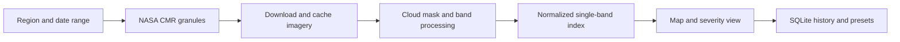

<div align="center">
  

  <a href="https://readme-typing-svg.demolab.com"></a>

  <p>
    
    
    
    <a href="LICENSE"></a>
  </p>
</div>

## 🌊 What it does

H.Y.D.R.A. is a Streamlit prototype for exploring satellite imagery over selected water regions. It queries NASA's CMR for Harmonized Landsat-Sentinel granules, processes imagery, and presents map-based analysis with saved presets and analysis history.

<p align="center">
  
  
</p>

## 🛰️ Processing path



## 🧪 Important measurement note

The current code calls its value `NDCI`, but computes a normalized single-band brightness index from the available composite. It is **not the standard red/red-edge NDCI formula**. The thresholds are prototype heuristics, not a validated environmental or public-health measurement. Treat the map as an exploratory visualization, not a confirmed bloom report.

## 🧰 Stack

| Area | Tools |
|---|---|
| Interface | Python, Streamlit, streamlit-folium, Folium |
| Imagery | NASA CMR, HLS, GIBS; Rasterio, NumPy, Pillow |
| Processing | Pandas, Matplotlib, Requests |
| Local state | SQLite, filesystem cache |

## 🚀 Run locally

```bash
git clone https://github.com/ChristopherJoshy/hydra.git
cd hydra
python -m venv .venv
# Windows: .venv\Scripts\Activate.ps1
# macOS/Linux: source .venv/bin/activate
pip install -r requirements.txt
streamlit run main.py
```

NASA Earthdata credentials may be needed to download source granules. Copy `.env.example` to `.env` and set credentials locally, or export them in the shell. Never commit the `.env` file.

## 🧪 Tests

```bash
pytest
```

## 🗂️ Layout

```text
main.py          Streamlit interface, CMR requests, processing and SQLite state
evaluate.py      analysis/evaluation helper
*.png            saved map views used as README examples
tests/           project tests
```

## 📄 License

MIT. See [`LICENSE`](LICENSE).